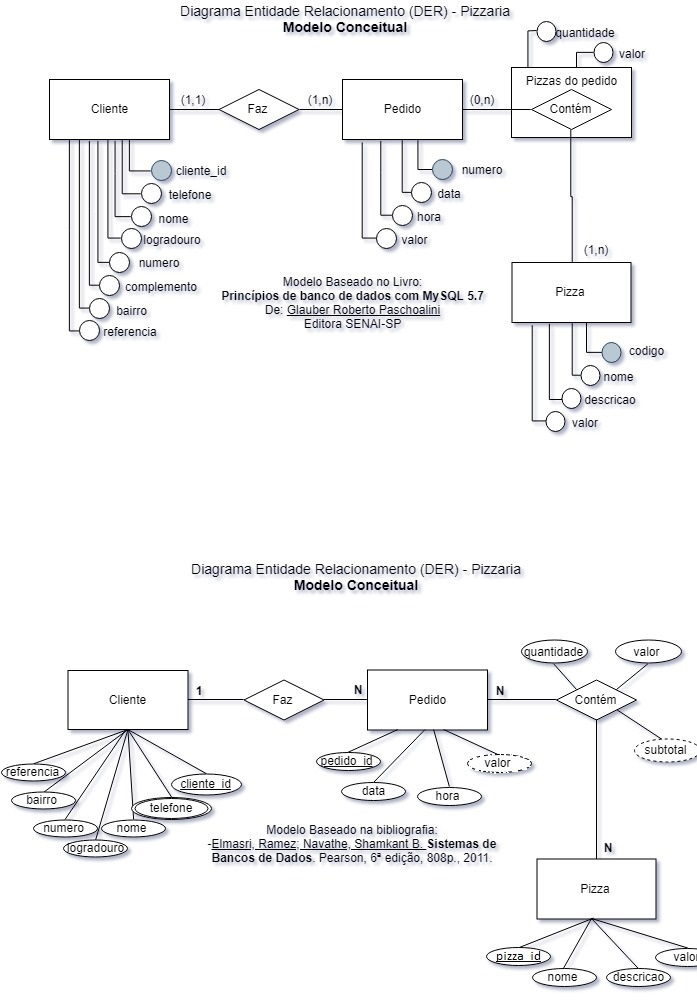
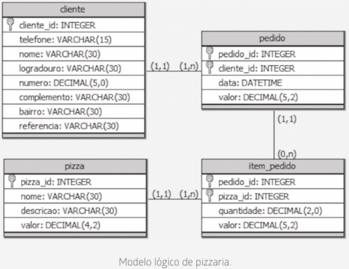

# Sistema de Pedidos de Pizzaria — Consultas SQL

Atividade desenvolvida na aula de Banco de Dados, utilizando MySQL para criar e manipular informações de uma pizzaria.

## MER DER Conceitual

## MER DER Lógico

## Atividades realizadas:

 - Consultas SQL;

 - Cadastro de clientes e pizzas;

 - Registro e atualização de pedidos;

 - Cálculo de valores e quantidades.

## Tecnologias utilizadas:

- MySQL Workbench
- Visual Studio Code

## Arquivos

- `queries.sql`: consultas e comandos SQL.
- `views.sql`: visualizações do banco de dados.
- `README.md`: descrição das atividades realizadas.
